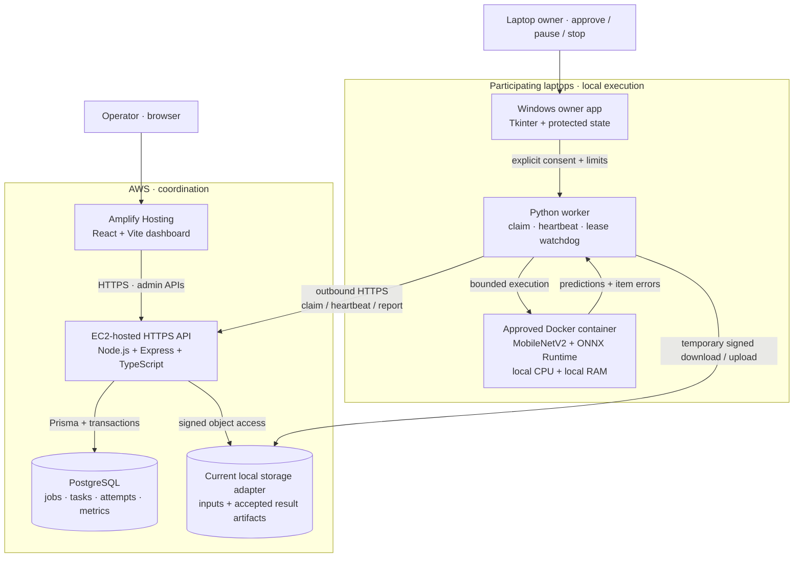

<p align="center">
  
</p>

<p align="center">
  <a href="https://main.d1kv8lel0y9bcf.amplifyapp.com/">Open the live dashboard</a> ·
  <a href="#demo-video">Demo video</a> ·
  <a href="#architecture">Architecture</a> ·
  <a href="#verification-and-evidence">Verification</a> ·
  <a href="#connect-a-worker-laptop">Connect a laptop</a>
</p>

<p align="center">
  <a href="https://github.com/dkush2024-dot/E-waste-computer-grid/actions/workflows/test.yml"></a>
  
  
  
</p>

# E-Waste Compute Grid

**A second computing life for usable retired laptops.**

E-Waste Compute Grid turns consenting, compatible idle computers into workers for independent image-processing batches. AWS hosts the coordination layer; participating laptops supply the CPU and RAM. An operator uploads once, workers pull their assigned batches, and the dashboard brings back predictions, execution history and accountable results.

Built for **Environmental Hacks — Track 03: Waste and Energy**, by **Kushagra, Vaibhav, Nikhil and Chinmay**.

| Reuse | Owner control | Recoverable execution | Visible outcomes |
| --- | --- | --- | --- |
| Put existing hardware to work | Pairing, approval, CPU/RAM ceilings, Pause and Stop | Leases, retries and stale-result fencing | Per-image predictions, worker attribution and downloadable JSON |

**What to look for:** a laptop owner explicitly approves participation; a real CPU model runs inside constrained Docker containers; interrupted work can be reassigned without double-counting accepted results.

**Recorded evidence:** 173 automated tests passed; a local Docker recovery run accepted 60 image inputs across 30 tasks using five frozen helpers on one PC. The hosted AWS dashboard and authenticated API reads were verified on 11 October 2026. [Inspect the evidence →](#verification-and-evidence)

## Demo video

<!-- TEAM: Replace the placeholder below with your public three-minute recording URL. -->
**Three-minute walkthrough:** https://youtu.be/aX740bk0eXg

Suggested recording: introduce the reuse problem → show the AWS dashboard → pair and approve a laptop → submit photos → inspect worker attribution and predictions → demonstrate Stop/recovery → explain the energy estimate.

The [official judging criteria](https://www.wemakedevs.org/aws/env) include impact, AWS usage, usability, execution and a three-minute recorded demo. The recording is the judges' demo experience, so it should show the actual working flow.

## Why this belongs in Waste and Energy

The world generated **62 million tonnes of e-waste in 2022**; **22.3%** was documented as formally collected and recycled. That is the context for our project, not a claim about waste we have already diverted. Source: [ITU/UNITAR Global E-waste Monitor 2024](https://www.itu.int/pub/D-GEN-E_WASTE.01-2024).

Our intervention is **reuse before disposal**: give a still-functional, supported laptop a useful computing role when it is no longer someone's primary machine. A college lab or community group could contribute approved devices to a shared batch-computing grid instead of immediately purchasing replacement compute capacity.

The connection to this track has three parts:

1. **Extend useful service.** Existing machines can contribute real computational output rather than remain unused. Actual device-life extension needs a deployment pilot and inventory evidence.
2. **Make participation practical.** Owners choose their limits, approve the grid and can stop. The installer removes the need to configure a full development environment on each contributing laptop.
3. **Make resource use inspectable.** The dashboard exposes accepted computation and estimated energy. Reuse is a hypothesis to evaluate: an inefficient old machine may consume more electricity than a modern alternative.

The current environmental contribution is the **computing reuse system**. The included classifier recognizes general ImageNet objects; it is not a trained wet-waste, plastic or electronic-waste sorting model. A future waste-classification application would need an appropriate dataset, model and evaluation.

## What you can do today

| Feature | User experience | Implementation |
| --- | --- | --- |
| Connect an owner-approved laptop | Prepare a code, invite it, approve locally | Expiring pairing sessions and per-worker credentials |
| Set participation limits | Choose CPU and RAM ceilings; Pause, Resume or Stop | Frozen approval policy, scheduler admission and Docker quotas |
| Submit real photographs | Upload photos and choose items per task | Indexed input identities, stored objects and durable batch creation |
| Run CPU inference remotely | Eligible workers claim batches automatically | MobileNetV2 through ONNX Runtime inside approved containers |
| Inspect every outcome | See predictions, confidence, item errors and batch history | Paginated jobs, tasks and durable attempt records |
| Recover interrupted work | Another eligible worker can retry the batch | Bounded leases, heartbeat renewal and recovery sweeps |
| Cancel unfinished jobs | Retain accepted output and cancel outstanding inputs | Transactional cancellation and rejection of late completions |
| Export results | Download aggregated JSON | Validated input coverage and one accepted metric per task |
| Prepare workloads offline | Import a verified archive before joining | SHA-256 checks, immutable image IDs and actual runtime preflight |
| Operate the Windows app | Use tray controls and optional login launch | Frozen GUI/helper, per-user installer and protected local state |

The grid currently executes two approved workloads: **real image inference** and a clearly labelled **synthetic pipeline demo**. It does not remotely execute arbitrary submitted code, combine laptops into shared RAM, or accelerate an unrelated application automatically.

## Architecture



**AWS coordinates; the laptops compute.** Workers initiate outbound connections, so they do not need an incoming laptop port or the same LAN. Each batch uses the selected worker's own memory. Multiple workers can process different batches concurrently.

### One job, from upload to result

1. The browser uploads input files and submits a job with a unique idempotency key.
2. The API assigns stable indexed names, splits the input list and stores the job/tasks in PostgreSQL.
3. A worker advertises only workloads that passed real preflight. It claims an eligible queued task using PostgreSQL row locking with `FOR UPDATE SKIP LOCKED`.
4. The assignment includes a lease token and temporary input URLs. The host agent downloads the assigned bytes and runs a reviewed container without network access.
5. Heartbeats renew the active lease within a maximum attempt deadline. An independent monotonic watchdog stops expired computation even if a heartbeat request is blocked.
6. The agent uploads the result artifact. The API validates its input identities, counts, predictions/errors and current ownership before accepting completion.
7. The dashboard aggregates accepted results, exposes attempt history and provides a JSON download. Expired work can be requeued for another eligible worker.

**Example:** 1,000 images at 10 items/task creates 100 tasks. Five eligible workers can claim different tasks concurrently. Assignment is FIFO with capability and approved-RAM eligibility; it does not promise an equal 20 tasks per laptop. Transfer overhead, model startup and device speed affect performance.

### Engineering decisions

| Decision | Reason |
| --- | --- |
| PostgreSQL as the durable queue | Task state, ownership and accepted metrics can commit together; no separate queue service is needed for this prototype |
| Worker-initiated HTTP polling | Works across ordinary home/campus networks without inbound worker connections |
| Independent batches | A clear unit for parallelism, retry, attribution and cancellation |
| Leases and attempt tokens | Failed or disconnected workers do not own a task indefinitely; old attempts cannot overwrite new outcomes |
| Approved immutable runtime images | A release identifies the workload actually executed, rather than relying on a mutable tag |
| Separate host agent and container | The agent handles network credentials; the compute container has no network and receives only staged inputs/output mounts |
| Cloud coordinator, local CPU inference | Centralized orchestration with computation on contributing hardware; cloud inference services are not required by the current workload |

## AWS deployment

| Component | Role | Current status |
| --- | --- | --- |
| **AWS Amplify Hosting** | Hosts the built React dashboard | [Live HTTPS application](https://main.d1kv8lel0y9bcf.amplifyapp.com/) |
| **Amazon EC2** | Team-deployed backend coordinator | [HTTPS API readiness](https://maxheap-grid.duckdns.org/api/ready); public API behavior verified, account/resource inventory not independently audited |
| **AWS SDK for JavaScript v3 + Amazon S3 adapter** | Optional private object storage with presigned GET/PUT URLs | Implemented in source; the current deployment reports `storage: local`, so S3 is not claimed as active |
| **PostgreSQL + Prisma** | Durable coordination and migration history | Used by the application; no Amazon RDS deployment is claimed |
| **DuckDNS + HTTPS endpoint** | Backend hostname and encrypted transport | External DNS, not an AWS service |

**Deployment verification — 11 October 2026:** dashboard and API reachable over HTTPS; health, liveness and database readiness returned 200; authenticated dashboard/job-list requests succeeded; browser displayed **Connected to your grid**; CORS allowed the Amplify origin. That check observed an empty grid and did not submit an AWS inference job.

The event permits an AWS-deployed project as one route to its AWS requirement. This project uses the hosted route, with Amplify and the team-deployed EC2 coordinator. See the [official event page](https://www.wemakedevs.org/aws/env); final eligibility is determined by the organizers.

### Important deployment settings

| Setting | Purpose |
| --- | --- |
| `VITE_API_URL` | Frontend build-time backend address; current hosted value is `https://maxheap-grid.duckdns.org/api` |
| `PUBLIC_API_URL` | Backend base used for signed local-storage URLs; must be reachable by worker laptops |
| `CORS_ORIGINS` | Allowed dashboard origins; include the exact Amplify HTTPS origin |
| `DATABASE_URL` | PostgreSQL connection for the existing deployment |
| `ADMIN_TOKEN` | Dashboard administration credential; not an AWS login or worker pairing code |
| `ENROLLMENT_TOKEN`, `ALLOW_LEGACY_ENROLLMENT` | Legacy development enrollment; use approval-only admission for a public grid |
| `STORAGE_DRIVER`, `STORAGE_SECRET` | Object-storage adapter and local URL signing secret |

Vite embeds `VITE_API_URL` at build time: changing it requires a frontend rebuild/redeploy. A hosted HTTPS dashboard must use an HTTPS API. Backend upgrades must include dependency installation, compilation and `npm run db:deploy` before restarting the updated server. Git pulls alone do not update a running process.

Production configuration requires unique non-development secrets and an HTTPS public API URL. Public-demo hardening still includes rotating development credentials and reviewing the running deployment. Keep secrets out of the README, frontend build variables, screenshots and Git.

## Technology stack

| Layer | Technologies | Responsibility |
| --- | --- | --- |
| Dashboard | React 19, TypeScript, Vite 8, Lucide, native Fetch, Oxlint | Invitations, uploads, jobs, task/attempt views, cancellation and export |
| Control plane | Node.js 22, Express 5, TypeScript, Prisma 5 | Authentication, validation, scheduling, leases and aggregation |
| Persistence | PostgreSQL, SQL transactions, indexed task state, versioned Prisma migrations | Durable jobs, assignments, history and duplicate-safe accounting |
| Cloud/storage integration | Amplify Hosting, EC2; optional AWS SDK v3/S3 adapter | Hosted UI/API and pluggable object transfers |
| Worker | Python, Requests, psutil, Docker SDK, python-dotenv | Hardware discovery, staging, heartbeat, execution and recovery |
| Owner application | Tkinter, pystray, Windows DPAPI | Consent, limits, tray controls and protected per-user identity |
| Workload | MobileNetV2, ONNX Runtime 1.17.1, NumPy, Pillow | CPU image preprocessing and 1,000-class inference |
| Delivery | Docker/Compose, PyInstaller, NSIS, SHA-256 release manifests | Reproducible runtimes, frozen app and Windows installer |
| Verification | Node test runner, Python unittest, real PostgreSQL integration, GitHub Actions | Contracts, races, migration behavior, worker lifecycle and packaging |

### What the AI output means

Images are decoded, corrected for EXIF orientation, converted to RGB, resized to 224 × 224 and normalized for the pinned MobileNetV2 model. ONNX Runtime executes on the worker CPU and returns a top class and score. The model, label mapping and runtime archive are checked against release hashes.

The JSON output contains image identity, `classId`, `className`, `confidence` and accepted task identity, plus errors and job accounting. It can feed an image inventory, a review queue or another application. Confidence is a model score, not a guarantee of correctness; completing every input is not classification-accuracy validation.

Model provenance: [ONNX Model Zoo MobileNet](https://github.com/onnx/models/tree/main/validated/vision/classification/mobilenet); label source: [PyTorch Hub ImageNet labels](https://github.com/pytorch/hub/blob/master/imagenet_classes.txt). The pinned hashes are in [the artifact manifest](workloads/ai-inference/models/artifact-manifest.json), and sample-photo provenance is in [the demo manifest](workloads/test-data/demo-manifest.json).

## Reliability, consent and boundaries

| Failure or concern | Implemented behavior |
| --- | --- |
| Double submission or lost response | Idempotency key returns the same job; conflicting reuse is rejected |
| Concurrent claims | Row locks prevent two workers accepting the same current assignment |
| Worker crash / lost network | Lease expiry makes work recoverable; the worker watchdog stops expired computation |
| Late or repeated completion | Attempt ownership is checked; accepted task output/metrics are duplicate-safe |
| Corrupt photo | Per-item errors are visible; task completion is distinguished from successful image outcomes |
| Missing, duplicate or unassigned output | Exact input-set validation rejects incorrect result artifacts |
| No compatible worker | Tasks remain queued; the dashboard explains capability/RAM eligibility |
| Owner pauses or stops | Pause drains current work without new claims; Stop cancels owned execution |
| Operator cancels a job | Accepted results remain; unfinished inputs are cancelled and late completion is fenced |
| Corrupt runtime / unavailable Docker | Preparation fails visibly; packaged workers do not silently use synthetic/native fallback |
| Upgrade or uninstall | Owned processes are stopped; same-account protected owner state is preserved |

Container controls include CPU/RAM limits, no extra swap, a read-only root filesystem, read-only inputs, no network, dropped capabilities, `no-new-privileges` and a process limit. These constrain an approved workload; they do not establish a sandbox for hostile arbitrary code or attest that an untrusted worker returned honest predictions.

Temporary pairing codes require **owner approval**. Worker-only laptops do not need the administrator token. Saved Windows credentials/settings use DPAPI; startup is opt-in and opening the app at login does not automatically start computation. Cleanup targets this worker's owned processes/containers rather than killing all Python or Docker processes.

## Energy accounting and environmental validation

The live dashboard uses an explicitly **ESTIMATED** metric:

```text
Estimated accepted compute energy (Wh)
    = sum(hardware baseline power in W × accepted execution time in ms / 3,600,000)
```

This excludes retries, input staging, transfers, idle-host energy, Docker/WSL overhead outside the recorded execution scope and AWS coordination energy. Online CPU capacity describes participation ceilings, not measured utilization. Cumulative accepted compute time and elapsed job time are different because tasks can overlap.

To evaluate the environmental proposition, a real pilot must record the devices retained in service, wall-meter energy, useful output and elapsed time against a defined alternative. Hardware manufacturing avoided, net carbon savings, fleet speedup and e-waste diverted are **not yet measured results**. Benchmark/energy utilities exist in `workloads/`; their illustrative baselines are not evidence of live cloud savings.

## Verification and evidence

**Recorded software checkpoint: 10 October 2026.** These are completed checks linked to artifacts, not tests rerun during this README redesign.

| Check | Recorded result | Evidence |
| --- | --- | --- |
| Worker suite | **100 passed** | [Verification ledger](output/onboarding/remaining-verification.json) |
| Workload suite | **32 passed** | [Verification ledger](output/onboarding/remaining-verification.json) |
| Backend suite | **41 passed**, including three actual database migration cases | [Verification ledger](output/onboarding/remaining-verification.json) |
| Frontend | Production build and lint passed; browser flows exercised | [Verification ledger](output/onboarding/remaining-verification.json) |
| Five frozen helpers + real Docker | **60 image inputs, 30 tasks, 30 accepted metrics**; owned helper crash recovered | [Runtime report](output/onboarding/remaining-five-worker.json) · [Accepted results](output/onboarding/remaining-five-worker-results.json) |
| Blocked heartbeat recovery | Expired owned compute stopped **4.640 s after simulated network loss**, with a five-second test lease; surviving helper accepted the 100-item synthetic batch once | [Network fault report](output/onboarding/remaining-network.json) |
| Windows installer | Install, 0.6.1 → 0.6.2 upgrade, GUI/tray smoke and uninstall passed under private same-account state | [Installer report](output/onboarding/remaining-installer.json) |
| Remote CI | Windows packaging and integration jobs passed for `aee3517` | [Successful GitHub Actions run](https://github.com/dkush2024-dot/E-waste-computer-grid/actions/runs/38055040853) |
| AWS connection | HTTPS dashboard/API, authenticated reads and readiness verified on 11 October | [Live dashboard](https://main.d1kv8lel0y9bcf.amplifyapp.com/) · [Readiness](https://maxheap-grid.duckdns.org/api/ready) |

The **173 automated tests** cover the recorded backend/worker/workload checkpoint. The five-helper and blocked-network tests ran on **one Windows PC**, not five physical laptops. Those runs establish the exercised protocol and Docker behavior, not a physical-fleet speedup or energy saving. AWS job execution and separate-device acceptance remain distinct checks.

<details>
<summary><strong>See the dashboard: batch attribution, partial results and attempt history</strong></summary>


This screenshot is from a local browser acceptance fixture with synthetic predictions and simulated worker rows. It demonstrates the interface; the Docker report above supplies the real inference execution evidence. It is not a screenshot of completed AWS processing.

</details>

## Connect a worker laptop

**Use this path for a Windows x64 contributor.** The AWS coordinator is already hosted; a worker-only laptop needs internet, a supported Docker Desktop/WSL setup, the worker installer and the matching workload archive. It does not need the backend, frontend, source checkout, system Python or dataset.

1. Obtain the team's **0.6.2 Setup EXE**, its checksum record and the matching **team-offline-v2 `images.tar`**. Source pulls do not include these large artifacts. The [Windows CI artifact](https://github.com/dkush2024-dot/E-waste-computer-grid/actions/runs/38055040853) contains the app build; obtain the runtime archive separately from the team. GitHub artifact access/retention applies.
2. Start [Docker Desktop](https://docs.docker.com/desktop/setup/install/windows-install/) with Linux containers. Install the worker and open **E-Waste Grid Worker**.
3. Enter `https://maxheap-grid.duckdns.org/api` as **Grid API address**. Choose a laptop name and approved limits; default dashboard image jobs need at least **2 GiB** of approved workload RAM, with additional host/Docker overhead.
4. Click **Import offline workloads**, select the matching archive and wait for verification and real runtime preflight.
5. Click **Prepare connection** and share the eight-character, case-sensitive code with the grid operator.
6. The operator enters it under **Invite a laptop → Send invitation** in the [dashboard](https://main.d1kv8lel0y9bcf.amplifyapp.com/).
7. The owner reviews the invitation and clicks **Approve and start**. Keep Docker and the worker running; closing the owner window stops participation.

Upload **10 photos**, set **2 items/task** and submit a named image-classification job. Expect five batches once an eligible worker participates. Inspect input outcomes and worker history, then download JSON. To demonstrate distribution, start distinct approved workers on multiple physical laptops and retain their task-attribution evidence.

The administrator token comes from the backend's `ADMIN_TOKEN` configuration. It is separate from AWS console access, SSH credentials and a worker's pairing code. Request demo access from the team; deployment credentials are not published here.

Full installer/checksum/owner instructions: [Windows release guide](docs/WINDOWS_WORKER_RELEASE.md). Required physical tests: [acceptance checklist](docs/STEP7_PHYSICAL_ACCEPTANCE.md).

## Run the coordinator locally

For development or a LAN rehearsal, install Docker with Linux containers and Compose. From the repository root in PowerShell:

```powershell
# Preserve an existing environment file and database configuration.
if (-not (Test-Path infra\.env)) { Copy-Item infra\.env.example infra\.env }
docker compose --env-file infra/.env -f infra/docker-compose.yml up -d --build
docker compose --env-file infra/.env -f infra/docker-compose.yml ps
Invoke-RestMethod http://localhost:8080/api/ready
```

Open `http://localhost:5173` and use the admin token configured in `infra/.env`. Default services are the database, control plane and dashboard. Container startup runs the supported migration deployment command. For a local worker, use `http://localhost:8080/api`; HTTP must be explicitly allowed for this trusted local demo.

For a physical LAN worker, use the coordinator's current private IP, configure `API_BIND_ADDRESS=0.0.0.0` and the appropriate reachable `PUBLIC_API_URL`, and permit only the required private-network API access. Keep PostgreSQL private. The hosted AWS workflow above does not require these LAN changes.

<details>
<summary><strong>Developer setup, migrations, tests and operations</strong></summary>

### Source-based worker and model preparation

Use Node.js 22.12+ for source application builds and Python 3.12 for the tested development setup. Create a fresh environment on each developer machine; do not copy a teammate's virtual environment.

```powershell
py -3.12 -m venv .venv-local
.\.venv-local\Scripts\python.exe -m pip install -r worker\requirements.txt -r workloads\ai-inference\requirements.txt
.\.venv-local\Scripts\python.exe workloads\ai-inference\download_model.py
.\.venv-local\Scripts\python.exe workloads\test-data\setup_sample_data.py
.\.venv-local\Scripts\python.exe worker\desktop.py --api-url http://localhost:8080/api --allow-http
```

If `py` is unavailable, use the path to your Python installation. In the source desktop, import the matching team-offline-v2 archive and follow the same preparation/invitation/approval flow as the installed app. Both use the reviewed immutable release. Rebuilding the Dockerfiles under a tag does not guarantee those exact image IDs; use [the offline-runtime build procedure](docs/OFFLINE_RUNTIME.md) when creating a new reviewed release. The preflight probe checks runtime health, not classifier accuracy. Downloads fail visibly rather than substitute synthetic photos or model output.

### Database upgrades

Back up the existing database and stop old application/worker processes before upgrading. In `control-plane`, retain the existing environment and run:

```powershell
npm ci
npm run db:deploy
npm run build
npm start
```

`db:deploy` supports a fresh schema and the exact supported old/current baseline. Unexpected drift is refused without resetting data. Do not replace the existing database configuration or use reset/accept-data-loss flags to bypass a migration error. Older documents mentioning `db push` are historical; the current release uses versioned migration deployment.

### Repeat the checks

```powershell
.\.venv-local\Scripts\python.exe -m unittest discover -s worker\tests -v
.\.venv-local\Scripts\python.exe -m unittest discover -s workloads\tests -v
```

Run `npm ci` and `npm test` inside `control-plane`. Set `TEST_DATABASE_URL` to a disposable PostgreSQL database and `TEST_PYTHON` to your environment's absolute executable path; integration tests otherwise skip. Tests create isolated schemas. In `frontend`, run `npm ci`, `npm run build` and `npm run lint`.

The [GitHub Actions workflow](.github/workflows/test.yml) runs PostgreSQL integration, workload and worker checks, frontend build/lint, plus a Windows packaging job. The compiler downloader validates pinned checksums and has mirror/HTML/corrupt-cache recovery checks.

### Operations

```powershell
docker compose --env-file infra/.env -f infra/docker-compose.yml logs --tail 100
docker compose --env-file infra/.env -f infra/docker-compose.yml down
```

`down` retains the named database/object volumes; adding `--volumes` destroys that state. Health routes: `/api/live` checks the process, `/api/ready` checks database readiness and `/api/health` reports database health/storage driver. API errors carry request IDs and sanitized messages.

The local Compose prototype includes two optional native simulation workers under `--profile simulation`. They exercise the protocol inside containers; they are not two physical laptops or Docker-isolated edge workloads.

Developer reference: [software completion and upgrade handoff](docs/SOFTWARE_COMPLETION.md), [worker protocol](docs/WORKER_ONBOARDING.md), [offline runtime](docs/OFFLINE_RUNTIME.md), [API contract](docs/api_contracts.md).

</details>

## Repository map

```text
control-plane/  Express API, Prisma schema/migrations, validation and integration tests
frontend/       React dashboard, job browser and authenticated API client
worker/         Owner app, agent, approved runtime, protected state and worker tests
workloads/      Real inference, synthetic demo, sample provenance, benchmarks and energy utilities
infra/          Local Compose stack and service Dockerfiles
scripts/        Packaging, offline runtime preparation and repeatable acceptance harnesses
.github/        Integration and Windows packaging CI
docs/           Contracts, release instructions, architecture decisions and team handoffs
output/         Checked-in verification reports and screenshots; large release binaries excluded
```

Core data entities are **Node, PairingSession, Job, Task, TaskAttempt and Metric**. `TaskAttempt` retains assignment history; `Metric` has unique task accounting. For the implementation behind the guarantees, start with [API and task state](control-plane/src/app.ts), [result validation](control-plane/src/validation.ts), [job reads](control-plane/src/job_reads.ts), [worker leases](worker/agent.py) and [container execution](worker/task_executor.py).

## Next milestones

| Milestone | What establishes it |
| --- | --- |
| Physical grid acceptance | Separate-device processing, then two-to-five real laptops with attribution, overlap and actual network/worker loss |
| Cloud execution acceptance | Approved physical worker completes a real uploaded batch through the hosted HTTPS API and returns downloadable results |
| Environmental pilot | Retained-device inventory, metered energy and useful-work comparison against a defined alternative |
| Waste-specific application | Suitable dataset/labels, validated model and updated workload/result contract |
| Broader deployment | Credential rotation, deployment/network review, persistent storage/backups, access model and quotas |
| Wider worker release | Clean-machine/reboot matrix, signed distribution and supported-device compatibility evidence |

The roadmap extends a working compute pipeline. Current boundaries include a single coordinator, shared-token administration, an unsigned Windows x64 development installer, Linux/amd64 workload images and Docker/WSL prerequisites. It is not yet a public multi-tenant or high-availability service. Hardware that cannot support the runtime needs another reuse route.

**Our proposition:** make existing computers useful again, give their owners control, and show where every batch went. The cloud provides coordination; the second life happens on the laptops.

## Contributors

* **Nikhil Kumar** ([@Nikhil10510](https://github.com/Nikhil10510)) — AI inference workloads, model optimization, and AWS deployment
* **Kushagra** ([@dkush2024-dot](https://github.com/dkush2024-dot)) — Architecture, coordination plane, and task scheduler
* **Vaibhav** ([@vaibhavdevelopor](https://github.com/vaibhavdevelopor)) — Control plane, database, and integration
* **Chinmay** — ([@chinmayp-17](https://github.com/chinmayp-17)) - Worker agent runtime and infrastructure

